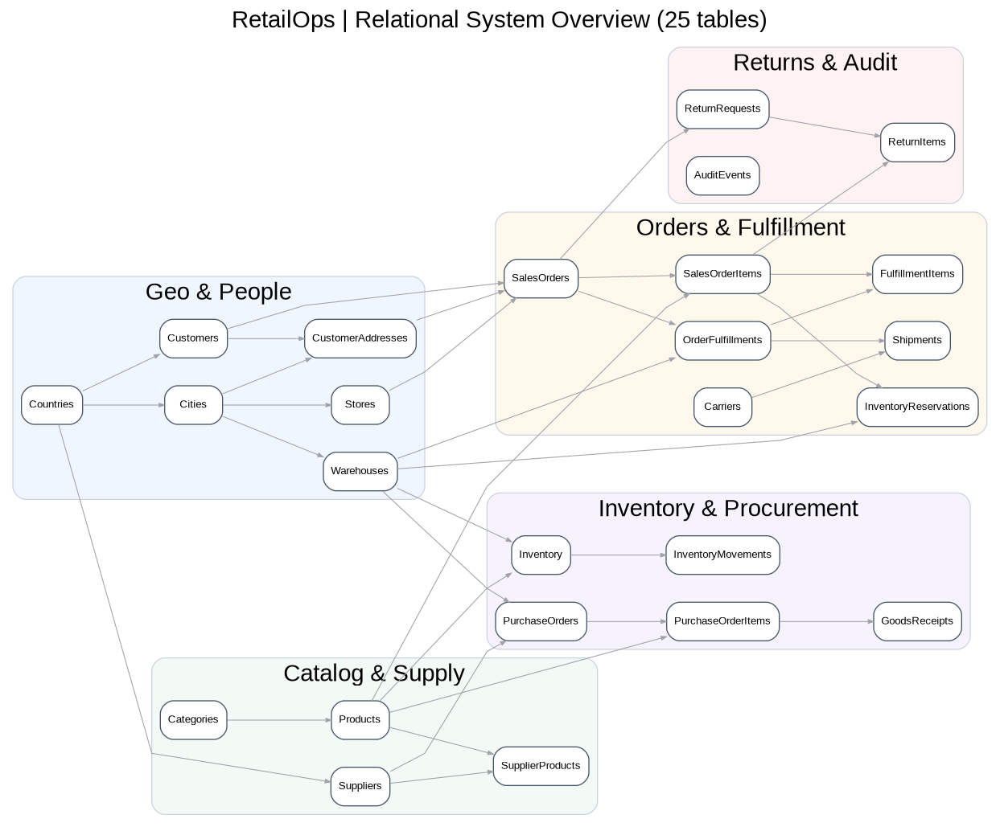
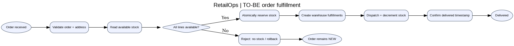
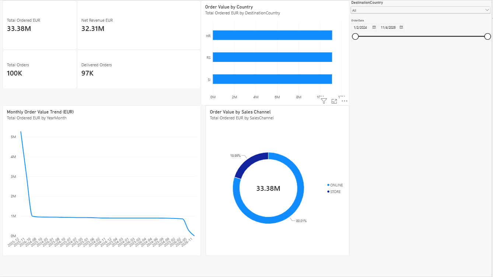
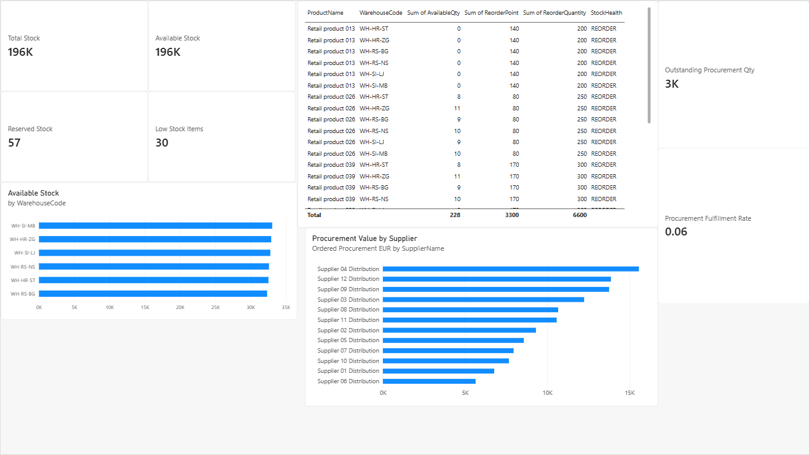
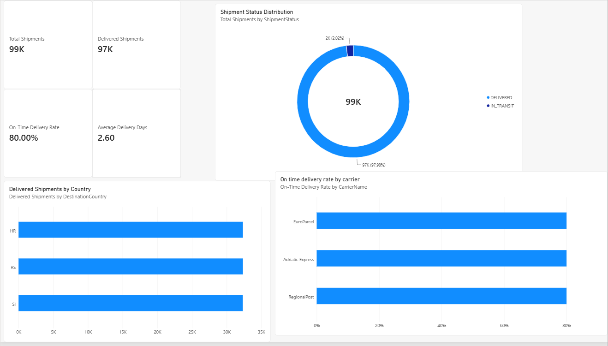

# RetailOps — Enterprise Order & Inventory Management System

> **Business Analysis • Systems Analysis • Microsoft SQL Server • Testing • Power BI**  
> Independent, educational portfolio case study. Fictional multinational retailer, Serbia/Croatia/Slovenia, 6 warehouses, 25 relational tables, 100,000 synthetically generated historical orders. **Not a real client deployment.**



## Business problem and scope

RetailOps models the operational challenge of knowing **where inventory is available**, whether an order can be allocated **without overselling**, and which **products, warehouses, suppliers and couriers** need management attention. The scope covers order creation, allocation, dispatch, delivery, cancellation, procurement receipt, returns, and warehouse-level inventory tracking.

The analysis artifacts include a [Business Requirements Document](business-analysis/01_BRD.md), [12 user stories and acceptance criteria](business-analysis/02_user_stories_acceptance.md), [requirements traceability matrix](business-analysis/05_requirements_traceability.csv), [System Requirements Specification](system-design/00_SRS.md), logical ERD, BPMN TO-BE model, and technical design documents.

## What was built

| Workstream | Contents | Location |
|---|---|---|
| Relational database | 25 tables, keys and constraints, seven operational stored procedures | [`database/`](database/) |
| Synthetic data | 100,000 generated historical orders, related lines and operational records | [`database/03_seed_data.sql`](database/03_seed_data.sql) |
| Reporting layer | Five SQL views for sales, inventory, fulfillment and procurement | [`database/05_views.sql`](database/05_views.sql) |
| Business/system analysis | BRD, SRS, user stories, acceptance criteria, traceability, KPI definitions | [`business-analysis/`](business-analysis/), [`system-design/`](system-design/) |
| SQL verification | Eight integration tests, three negative tests, two-session concurrency scenario | [`testing/`](testing/) |
| Analytics | SQL business questions and a performance study | [`analytics/`](analytics/) |
| Power BI | Three-page local Power BI report (Sales Performance, Inventory & Supply Chain, Order Fulfillment) | [`powerbi/`](powerbi/) |
| Case-study presentation | Interview pitch and presentation files | [`presentation/`](presentation/), [`deliverables/`](deliverables/) |



## Implementation details

- **Reservation safety:** available stock is modeled as on-hand minus reserved quantity. Allocation locks inventory and prevents allocating units beyond availability.
- **Split fulfillment:** allocation can satisfy an order using multiple warehouses; domestic warehouse preference is a simplified business rule.
- **Traceability:** movement/ledger and audit records track material operations; order-line price and cost snapshots support reporting.
- **Idempotency:** a repeated external request key returns the same order only when its payload is consistent; conflicting payloads are rejected.
- **Demo reporting policy:** sales value for active/non-cancelled orders excludes `CANCELLED`; `AllOrders` still counts all placed orders, including cancelled. Revenue and margins follow simplified demonstration rules, **not full statutory accounting**. See [KPI dictionary](business-analysis/03_KPI_dictionary.md).

## Quick start — SQL Server Express / SSMS

**Requirements:** Microsoft SQL Server 2019+, SQL Server Management Studio, permission to create a local demo database, and sufficient disk space. Windows Authentication is suitable for a local instance. These scripts are intended for a **new, empty, disposable** `RetailOpsDB` and are **not designed as a general re-run/migration system**. Do not use on production data.

Open and execute in order:

```text
database/00_create_database.sql
database/01_schema.sql
database/02_procedures.sql
database/03_seed_data.sql           # seeds 100,000 synthetic historical orders
database/04_indexes.sql
database/05_views.sql
database/06_demo_workflows.sql
```

Then run integration and negative tests on the demo installation:

```text
testing/01_integration_tests.sql
testing/02_negative_tests.sql
testing/04_post_install_validation.sql
```

For validation on larger datasets, the standalone optimized [`testing/05_validation_v07_fast.sql`](testing/05_validation_v07_fast.sql) avoids the original slow correlated check. It was run separately after V01–V06 in the local validation described below.

The concurrency scenario needs **two separate SSMS connections** and manual order-ID setup. Follow [`testing/03_concurrency_manual.md`](testing/03_concurrency_manual.md) and the four files in [`testing/concurrency/`](testing/concurrency/). Do not re-run setup just to repeat the test; each run creates new demo orders.

## Power BI report

The report was built locally in Power BI Desktop and connects to `RetailOpsDB` through an Import connection to five SQL views: `vw_DailySales`, `vw_SalesFact`, `vw_InventoryHealth`, `vw_FulfillmentPerformance`, `vw_ProcurementPerformance`. The three pages are:

1. **Sales Performance:** ordered value (excluding cancellations), net revenue, orders placed and delivered, monthly trend, country and sales-channel splits, date/country slicers.
2. **Inventory & Supply Chain:** on-hand/available/reserved units, warehouse availability, reorder-risk lines, procurement and supplier indicators.
3. **Order Fulfillment:** shipments, delivered shipments, on-time delivery rate, average delivery days, country, status and carrier comparisons.

If the report binary has been copied into this repo, open [`powerbi/RetailOps_Operations_Dashboard.pbix`](powerbi/RetailOps_Operations_Dashboard.pbix) in Power BI Desktop. The source connection points to a **local** `./SQLEXPRESS`-style SQL instance (in Windows connection syntax: `.\SQLEXPRESS`), so other users must configure their own SQL Server and update the data-source settings before refreshing. The report is for local use; Power BI Service publication is **not** claimed.

## Local verification — 2026-11-04

The following results were reported from actual SSMS execution on a local SQL Server 2025 Express instance. These are **demo-environment observations**, not automated CI or production guarantees.

| Check | Observed local outcome |
|---|---|
| Database schema and procedures | 25 tables; seven `usp_` procedures |
| Synthetic data load | 100,000 historical orders, 175,000 order lines, 5,000 customers, 99,000 shipments (seed summary) |
| Reporting objects | Five views; `vw_DailySales` returned grouped sales results |
| End-to-end demo | Delivered order and received return (`DELIVERED` / `RECEIVED`) |
| Integration tests | **T01–T08 PASS** (eight observed PASS messages) |
| Negative tests | **N01–N03 PASS** (expected errors handled) |
| Concurrency scenario C01 | Session A committed a reservation; Session B was rejected with expected error `51102` after waiting (3,317 ms); test orders then cancelled |
| Post-install controls | V01–V06 PASS; separate optimized V07 returned `MismatchCount = 0` |
| SQL reporting benchmark | Same query: 479 ms first run, 439 ms second; CPU 438 ms both, 1,975 logical reads both. **Caching difference, not proven optimization.** |

For per-test entries see [`testing/test_execution_log.csv`](testing/test_execution_log.csv) and for observed timings see [`testing/performance_results_template.csv`](testing/performance_results_template.csv). Screenshots and exact SSMS outputs should be retained as evidence when presenting the project.

## Limitations and interpretation

- All entities, customers, orders and operational KPIs are **synthetic**, not client data. Distribution shifts and seasonality are artifacts of the seed generator and should never be presented as empirical retail trends.
- EUR-valued prices are assumptions; there is no foreign-exchange conversion engine, VAT handling, payment integration, production security architecture, APIs, or full accounting compliance.
- Metrics have deliberate and sometimes simplified grains: `vw_SalesFact` is one row **per order line**; `vw_InventoryHealth` is one row **per warehouse/product**; procurement is one row **per purchase-order line**. Avoid interpreting rows as unique orders without distinct counts.
- Current `AllOrders` counts cancelled orders, while current `OrderedValueEUR` excludes them. Use the documented business definitions when comparing KPI totals.
- Local test outcomes are observations from one synthetic dataset. The GitHub Actions workflow runs **static bundle checks only**; it does not spin up SQL Server or open the Power BI report.
- Some operational SQL test scripts may intentionally create and cancel demo orders. The seed script should be executed only once for a new demo instance.

## Interview walkthrough

Start with the [BRD](business-analysis/01_BRD.md) and [user stories](business-analysis/02_user_stories_acceptance.md); trace the prevention-of-overselling requirement into the allocation stored procedure, N01 and concurrency C01. Show SQL execution evidence, then the three Power BI pages. Explain data-grain choices, the cancellation fix in the sales KPI and the limitations of the synthetic model. The presentation deck is in [`deliverables/`](deliverables/).


## Power BI Dashboards

### 1. Sales Performance


### 2. Inventory & Supply Chain


### 3. Order Fulfillment

