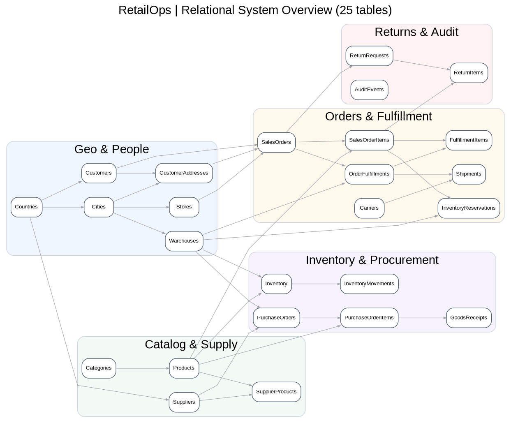

# Logical ERD — all 25 tables

**Editable source:** `01_ERD.dot` (Graphviz). **Rendered preview:** `../assets/retailops_erd.png`.

The arrows point from parent to child. This is a relationship overview; read `07_data_dictionary.md` for column-level types and constraints.

## Primary relationship list

- `Countries` → `Cities`
- `Cities` → `Stores`
- `Cities` → `Warehouses`
- `Countries` → `Customers`
- `Customers` → `CustomerAddresses`
- `Cities` → `CustomerAddresses`
- `Categories` → `Categories`
- `Categories` → `Products`
- `Countries` → `Suppliers`
- `Suppliers` → `SupplierProducts`
- `Products` → `SupplierProducts`
- `Warehouses` → `Inventory`
- `Products` → `Inventory`
- `Inventory` → `InventoryMovements`
- `Customers` → `SalesOrders`
- `CustomerAddresses` → `SalesOrders`
- `Stores` → `SalesOrders`
- `SalesOrders` → `SalesOrderItems`
- `Products` → `SalesOrderItems`
- `SalesOrderItems` → `InventoryReservations`
- `Warehouses` → `InventoryReservations`
- `SalesOrders` → `OrderFulfillments`
- `Warehouses` → `OrderFulfillments`
- `OrderFulfillments` → `FulfillmentItems`
- `SalesOrderItems` → `FulfillmentItems`
- `OrderFulfillments` → `Shipments`
- `Carriers` → `Shipments`
- `Suppliers` → `PurchaseOrders`
- `Warehouses` → `PurchaseOrders`
- `PurchaseOrders` → `PurchaseOrderItems`
- `Products` → `PurchaseOrderItems`
- `PurchaseOrderItems` → `GoodsReceipts`
- `SalesOrders` → `ReturnRequests`
- `ReturnRequests` → `ReturnItems`
- `SalesOrderItems` → `ReturnItems`

**Important implementation details:** Composite FK `(WarehouseID,ProductID)` from `InventoryMovements` to `Inventory`; many-to-many products/suppliers via `SupplierProducts`; many-to-many order items/warehouses via `InventoryReservations` and `FulfillmentItems`; `AuditEvents` uses polymorphic references intentionally and therefore has no entity FK.
