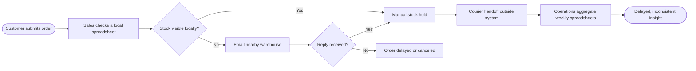

# Assumed current-state (AS-IS) process

> Fictional workshop artifact. This is a **hypothesized** current state, not a process discovered through real interviews.

| Pain point | Observable signal to validate with real users | Risk |
|---|---|---|
| Spreadsheet stock checks | Time spent answering availability requests | Oversell / delay |
| Ad hoc inter-warehouse emails | Average turnaround per transfer decision | Inventory fragmentation |
| Manual courier reconciliations | Percent tracked orders with missing delivered date | SLA blind spot |
| Weekly manual reports | Data disagreement between regional reports | Conflicting decisions |

**Elicitation plan:** semi-structured interviews with sales, warehouse manager and finance; shadow three real orders and three returns; validate current-state BPMN; identify process owners and pain-point baselines. These steps have NOT happened and would be part of a genuine client engagement.
