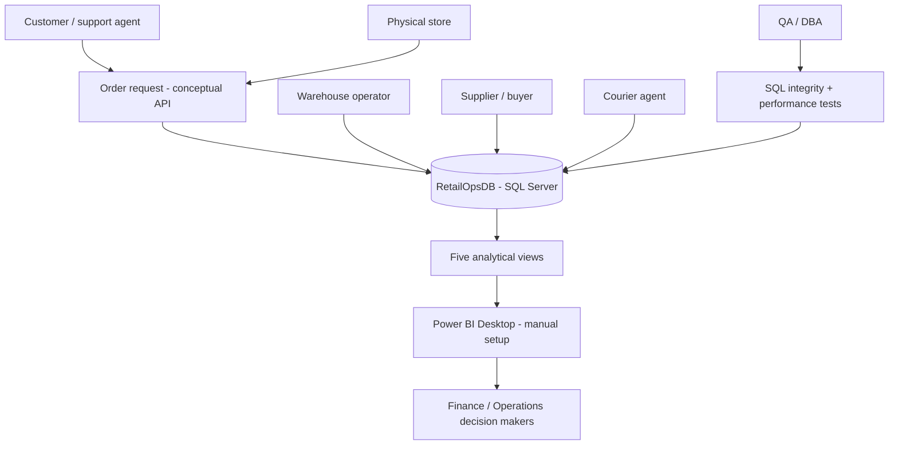

# System context and data flows

## Logical data flow

1. **Order payload** → SalesOrders, SalesOrderItems; customer and address checked.
2. **Allocation** → Inventory.QuantityReserved, InventoryReservations, OrderFulfillments, FulfillmentItems.
3. **Dispatch** → Inventory.QuantityOnHand, InventoryMovements, Shipments.
4. **Delivery** → Shipments status and OrderFulfillments/SalesOrders state.
5. **Procurement** → PurchaseOrders / GoodsReceipts / InventoryMovements.
6. **Returns** → ReturnRequests / ReturnItems / InventoryMovements.
7. **Insight** → views → Power BI.

Physical system is only SQL Server and its SQL scripts; arrows from external actors show *intended interactions*, not implemented integrations.
